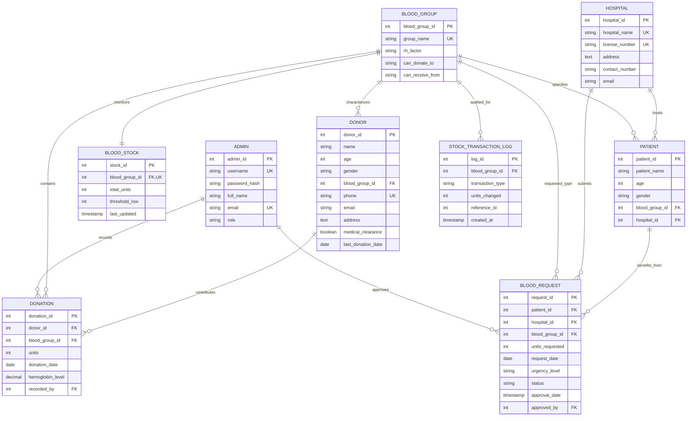

# Entity-Relationship (ER) Diagram Description
## Blood Bank Management System (BBMS)

This document provides a comprehensive structural specification of the relational schema, entity sets, attributes, keys, and cardinalities for the **Blood Bank Management System**.

---

## 1. Entity Sets and Attributes

| Entity | Primary Key | Attributes | Description |
| :--- | :--- | :--- | :--- |
| **ADMIN** | `admin_id` | `username`, `password_hash`, `full_name`, `email`, `role`, `created_at`, `last_login` | Authenticated system administrators and lab technicians. |
| **BLOOD_GROUP** | `blood_group_id` | `group_name`, `rh_factor`, `can_donate_to`, `can_receive_from`, `description` | Master reference entity for ABO & Rh blood types (A+, A-, B+, B-, AB+, AB-, O+, O-). |
| **BLOOD_STOCK** | `stock_id` | `blood_group_id` (FK), `total_units`, `threshold_low`, `last_updated` | Real-time inventory of units available for each blood group. |
| **DONOR** | `donor_id` | `name`, `age`, `gender`, `blood_group_id` (FK), `phone`, `email`, `address`, `medical_clearance`, `last_donation_date`, `created_at` | Voluntary blood donors with eligibility tracking. |
| **DONATION** | `donation_id` | `donor_id` (FK), `blood_group_id` (FK), `units`, `donation_date`, `hemoglobin_level`, `systolic_bp`, `diastolic_bp`, `notes`, `recorded_by` (FK) | Recorded donation transactions. |
| **HOSPITAL** | `hospital_id` | `hospital_name`, `license_number`, `address`, `contact_number`, `email`, `emergency_contact`, `created_at` | Partner hospitals, nursing homes, and trauma centers. |
| **PATIENT** | `patient_id` | `patient_name`, `age`, `gender`, `blood_group_id` (FK), `hospital_id` (FK), `contact_number`, `medical_condition`, `created_at` | Patients requiring blood transfusions. |
| **BLOOD_REQUEST** | `request_id` | `patient_id` (FK), `hospital_id` (FK), `blood_group_id` (FK), `units_requested`, `request_date`, `urgency_level`, `status`, `approval_date`, `approved_by` (FK), `remarks` | Blood requisitions made by hospitals on behalf of patients. |
| **STOCK_TRANSACTION_LOG** | `log_id` | `blood_group_id` (FK), `transaction_type`, `units_changed`, `reference_id`, `remarks`, `created_at` | Audit trail of inventory increments/decrements. |

---

## 2. Relationships and Cardinality Ratios

1. **DONOR to BLOOD_GROUP (N:1)**
   - *Relationship*: "Has Group"
   - *Cardinality*: Many donors belong to one blood group. One blood group can have zero or many registered donors.
   - *Participation*: Total on DONOR (every donor must have a blood group); Partial on BLOOD_GROUP.

2. **DONOR to DONATION (1:N)**
   - *Relationship*: "Makes Donation"
   - *Cardinality*: One donor can make multiple donations over time (0 to N). Each donation record is associated with exactly one donor.
   - *Participation*: Partial on DONOR (a registered donor might not have completed a donation yet); Total on DONATION.

3. **BLOOD_GROUP to BLOOD_STOCK (1:1)**
   - *Relationship*: "Inventory Count"
   - *Cardinality*: Each blood group has exactly one inventory stock record.
   - *Participation*: Total on both ends (every blood group has an inventory counter).

4. **HOSPITAL to PATIENT (1:N)**
   - *Relationship*: "Admitted In"
   - *Cardinality*: One hospital admits multiple patients. A patient is treated at one hospital.

5. **PATIENT & HOSPITAL to BLOOD_REQUEST (1:N & 1:N)**
   - *Relationship*: "Requests Blood"
   - *Cardinality*: A hospital issues requests for patients. Each request specifies patient, hospital, blood group, units, and urgency level.

6. **ADMIN to DONATION & BLOOD_REQUEST (1:N)**
   - *Relationship*: "Records / Approves"
   - *Cardinality*: Administrators record donation sessions and review/approve blood requisitions.

---

## 3. Relational Schema Diagram (Mermaid)

---

## 4. Integrity Constraints Enforced

- **Entity Integrity**: Every table possesses an explicit primary key (`AUTO_INCREMENT`).
- **Referential Integrity**: Foreign keys define parent-child relationships with `ON UPDATE CASCADE` and `ON DELETE RESTRICT` / `CASCADE` / `SET NULL` as appropriate.
- **Domain Constraints**:
  - `donor.age` CHECK constraint: `18 <= age <= 65`
  - `donor.gender` CHECK constraint: `IN ('Male', 'Female', 'Other')`
  - `donation.units` CHECK constraint: `units > 0`
  - `blood_stock.total_units` CHECK constraint: `total_units >= 0` (Prevents negative stock under concurrency)
  - `blood_request.status` CHECK constraint: `IN ('Pending', 'Approved', 'Rejected')`
  - `blood_request.urgency_level` CHECK constraint: `IN ('Normal', 'Critical', 'Emergency')`
